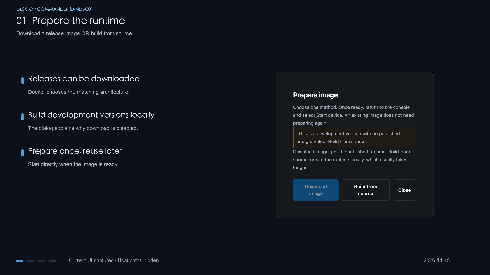
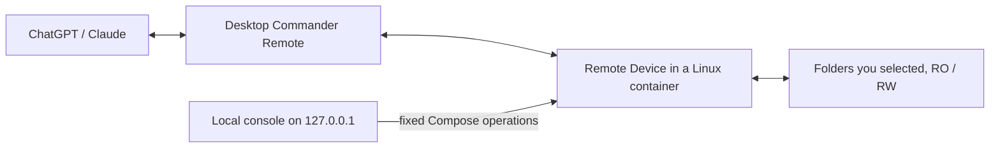

# Desktop Commander Sandbox

**Let ChatGPT or Claude on the web work with your local files, organize documents, and run scripts — in a Docker sandbox with per-folder permissions for the host files you share.**

[](LICENSE)


[English](README.md) | [简体中文](README.zh-CN.md)



A 13-second, 4K (3840 × 2160) walkthrough composed of current UI captures. Open the GIF to view it at full resolution. The final panel summarizes recorded acceptance results; it is not a live recording. Full-resolution stills: [Console](docs/assets/overview-en.png) · [Prepare image](docs/assets/prepare-en.png) · [Folder access](docs/assets/workspace-en.png).

[Desktop Commander Remote](https://mcp.desktopcommander.app/) lets ChatGPT and Claude run terminal commands and edit files on your machine. By default that machine is *your whole computer*. Desktop Commander Sandbox runs it in a locked-down Linux container instead, and gives you a local console to decide exactly which host folders to share — each one **read-only** or **read/write**.

> Independent community project; not affiliated with or endorsed by Desktop Commander. You need a ChatGPT or Claude account with Desktop Commander Remote connected.

## Quick start

Requirements: **Docker** with **Compose 2.24.1+**, and **Node.js 22.12.0+** (the host console has no npm dependencies).

Download and extract the project ZIP from [Releases](https://github.com/xinnie-live/desktop-commander-sandbox/releases). Double-click `start.command` on macOS or `start.cmd` on Windows, or run `sh start.sh` on Linux. The launcher checks prerequisites and opens the console. Before the first release, use the same scripts in the source directory.

For command-line use or source builds, clone the repository and open the console.

```sh
git clone https://github.com/xinnie-live/desktop-commander-sandbox.git
cd desktop-commander-sandbox
npm run remote-device:dashboard
```

In the console:

1. **Prepare image.** Select **Prepare image** and choose one method. Fetch the current release image containing Desktop Commander `0.3.3`. For development versions or local builds, select **Build from source**.
2. **Use the default workspace.** The first build or start prepares a writable `work/` folder and a read-only `reference/` folder. Create a workspace when you want to select your own folders.
3. **Start device.** On first start, open the official authorization page, check the device code, and approve it yourself. Never paste the code into a chat.
4. **Connect your AI client.** Enable the [Desktop Commander app in ChatGPT](https://chatgpt.com/plugins/plugin_asdk_app_6a057d268ebc81919918d37eec718425) or enter `https://mcp.desktopcommander.app/mcp` in a Claude connector. Confirm the device is online on the official device page, then try: *"Read /mnt/remote-device/reference/input.txt and write the line count to /workspace/report.json."*

On a fresh setup, `default` mounts `sandbox-workspace/default/work/` read/write at `/workspace` and its sibling `reference/` read-only at `/mnt/remote-device/reference`. Find the result on the host at `work/report.json`.

Prefer the terminal? `npm run remote-device:build` and then `npm run remote-device:start`. Run `node scripts/console.mjs --help` for every command.

New to Docker on Windows? Follow the [step-by-step setup](docs/USAGE.md#first-time-windows-setup); no separate Ubuntu installation or Linux terminal is needed. You can also give this repository URL to a local agent such as Codex using the [installation request](docs/USAGE.md#installation-with-a-local-agent).

## Why use it

| | Desktop Commander Remote on the host | With Desktop Commander Sandbox |
|---|---|---|
| Host file access | Everything your user account can reach | Only the folders you mount (1 main + up to 8 extra) |
| Write access | Everywhere your user can write | Per folder: read-only or read/write |
| SSH keys, browser profiles, cloud credentials | Readable | Not mounted, so not visible |
| Installed packages and toolchains | Change your host | Stay in the tool home volume when installed under `/home/tool` |
| Run history | Terminal scrollback | Local run logs (7 files × 10 MB max) |

Typical uses:

- **Create documents and reports.** Read selected source material and save Markdown documents, summaries, or reports to an output folder.
- **Organize files and reference material.** Classify and rename files, create an inventory, and confirm the organization rules before applying changes.
- **Process data.** Read CSV or JSON data, clean it, calculate statistics, and export results.
- **Understand and edit code.** Trace entry points, explain interfaces, and review `git diff` after changes.
- **Run scripts and tests.** Install the required Linux dependencies inside the container and execute tasks.

## How it works



Inside the container, your folders appear at fixed paths:

| Container path | Contents | After stop |
|---|---|---|
| `/workspace` | Main folder | Writes to read/write mounts persist on the host |
| `/mnt/remote-device/<name>` | Extra folders | Writes to read/write mounts persist on the host |
| `/home/tool` | AI tool home: configs, dependencies, runtime copies | Kept (named volume) |
| `/tmp` | 256 MB scratch space, no direct execution | Cleared |

A workspace is a saved set of folders and permissions. Switching workspaces keeps your sign-in and `/home/tool`.

## Security and data

The container limits host access by folder, runs tools under a separate identity, and exposes the local console only on `127.0.0.1`. AI tools can read read-only files, and tool output passes through the model provider and Remote relay. The container allows outbound network access. See the [security model](docs/SECURITY_MODEL.md) for the boundaries.

## Platform status

Prebuilt images are Linux container images, not OrbStack-specific installers. The release workflow is configured for `linux/arm64` and `linux/amd64`; Docker selects the matching variant once published. Multi-architecture builds do not establish end-to-end support on every host; the table below records actual verification. Unpublished development versions require a source build.

| Host | Status |
|---|---|
| macOS + OrbStack (arm64) | 0.1.0 candidate: offline/synthetic Docker checks, manually approved pairing, cloud synthetic read/write, read-only enforcement, UI permission changes and image replacement/reconnection passed. Native folder selection was previously accepted by the maintainer; it was not repeated in this automation session. |
| macOS + Docker Desktop | ⚠️ Expected to work, not yet verified |
| Linux x86_64 (Docker Engine) | Host regressions and synthetic container checks passed; see scope below. Selected folders require primary-group access. |
| Windows + Docker Desktop (WSL 2) | Container runtime unverified |

Linux evidence (2026-11-15, external retest): Debian 13 x86_64 host tests passed on Node 22 and 24 (75/75 each), including the two targeted path-security regressions. In a separate Alpine 3.24.4/QEMU x86_64 VM, Docker 29.9.3 / Compose 5.6.1 synthetic container checks passed. The build used a temporary BuildKit CA secret for the test network's proxy, kept TLS verification enabled, and reran dependency installation while reusing unchanged layers. This does not establish an unconditional build in other network environments.

The Linux browser check confirmed Docker-unavailable guidance and disabled controls. Native folder selection (missing zenity/kdialog), a complete UI-to-container flow in the same environment, real cloud pairing and upgrade reconnection remain unverified. These results do not cover every distribution, rootless Docker, SELinux, or Linux arm64. Windows and macOS Docker Desktop remain unverified; image architectures are build targets, not blanket acceptance claims.

Tried another setup? Please [open an issue](https://github.com/xinnie-live/desktop-commander-sandbox/issues) with the results, success or failure.

## Documentation

- [User guide](docs/USAGE.md): console, CLI, workspaces, logs, and proxies
- [AI workflow guide](docs/AI_WORKFLOW.md): runtime copies, dependencies, certificates, and a reusable task brief for the AI
- [Security model](docs/SECURITY_MODEL.md): assets, trust boundaries, and known gaps
- [Contributing](CONTRIBUTING.md): development setup, tests, and pull requests
- [Security policy](SECURITY.md): how to report a vulnerability privately
- [Changelog](CHANGELOG.md)

## FAQ

**Does my code stay on my machine?** Files stay on disk locally, but whatever the AI reads or runs is sent to the model provider (OpenAI or Anthropic) and the Desktop Commander relay. The sandbox limits *what* can be read; it does not make the AI local.

**Do I need to `npm install`?** No. The console uses only Node.js built-ins. Desktop Commander is installed inside the image during `build`.

**What happens to installed packages when I stop the device?** Anything under `/home/tool` is kept in a Docker volume. `/tmp` is cleared.

**Can I run several isolated devices?** Yes. Use `--project <name>` to give each one its own device state.

## License

[MIT](LICENSE). Desktop Commander and other dependencies keep their own licenses. See [third-party notices and source materials](THIRD-PARTY-NOTICES.md).

If this project is useful to you, a ⭐ helps other people find it.
