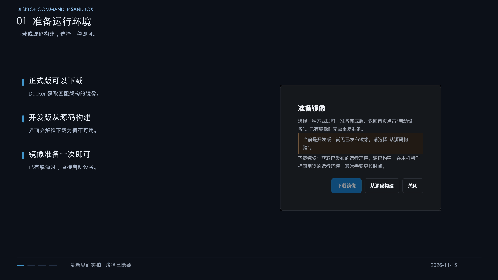
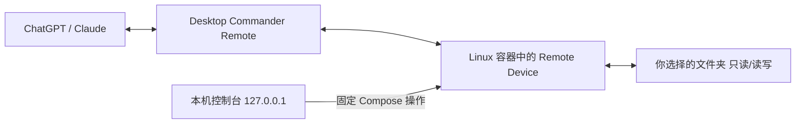

# Desktop Commander Sandbox

**让网页版 ChatGPT / Claude 处理你的本地文件、整理资料和运行脚本，由你选择哪些宿主机文件夹可访问，全部运行在加固的 Docker 沙箱里。**

[](LICENSE)


[English](README.md) | [简体中文](README.zh-CN.md)



最新界面实拍组成的 13 秒 4K（3840 × 2160）演示，打开 GIF 可查看原始分辨率；末段为已记录的验收结果摘要，并非实时录屏。查看高清静态图：[控制台](docs/assets/overview-zh.png) · [准备镜像](docs/assets/prepare-zh.png) · [文件夹权限](docs/assets/workspace-zh.png)。

[Desktop Commander Remote](https://mcp.desktopcommander.app/) 可以让 ChatGPT 和 Claude 在你的电脑上执行终端命令、编辑文件。默认情况下，它能访问的是**你的整台电脑**。Desktop Commander Sandbox 把它放进一个锁紧的 Linux 容器，并提供一个本机控制台，由你选择向 AI 开放哪些宿主机文件夹，每个文件夹单独设为**只读**或**读写**。

> 独立社区项目，与 Desktop Commander 官方无隶属或背书关系。需要已连接 Desktop Commander Remote 的 ChatGPT 或 Claude 账号。

## 快速开始

环境要求：**Docker**（Compose **2.24.1+**）和 **Node.js 22+**。本机控制台不依赖任何 npm 包。

从 [Releases](https://github.com/xinnie-live/desktop-commander-sandbox/releases) 下载项目 ZIP 并解压。macOS 双击 `start.command`，Windows 双击 `start.cmd`，Linux 运行 `sh start.sh`。启动器检查环境后打开控制台。首次发布前，可使用源码目录中的同名脚本。

习惯命令行或需要自行构建时，也可以获取源码后运行控制台。

```sh
git clone https://github.com/xinnie-live/desktop-commander-sandbox.git
cd desktop-commander-sandbox
npm run remote-device:dashboard
```

在控制台中：

1. **准备镜像**：点击“准备镜像”，选择一种方式。下载当前发行版的预制镜像，内含 Desktop Commander `0.3.3`。开发版或需要自行构建时，点击“从源码构建”。
2. **使用默认工作区**：首次运行会准备两个示例目录，读写的 `work/` 和只读的 `reference/`。需要操作自己的文件时，再新建工作区。
3. **启动设备**：首次启动时打开官方授权页面，核对设备码后由你本人批准。不要把设备码贴进聊天。
4. **连接 AI 客户端**：在 ChatGPT 中启用 [Desktop Commander 应用](https://chatgpt.com/plugins/plugin_asdk_app_6a057d268ebc81919918d37eec718425)，或在 Claude 的连接器中填写 `https://mcp.desktopcommander.app/mcp`。在官方设备页确认设备在线后，试试：*“读取 /mnt/remote-device/reference/input.txt，把行数写入 /workspace/report.json。”*

全新配置的 `default` 把 `sandbox-workspace/default/work/` 以读写挂载到 `/workspace`，把同级的 `reference/` 以只读挂载到 `/mnt/remote-device/reference`。结果会写到宿主机的 `work/report.json`。

更习惯终端？依次运行 `npm run remote-device:build` 和 `npm run remote-device:start`。`node scripts/console.mjs --help` 可查看全部命令。

Windows 新手请看[逐步安装说明](docs/USAGE.zh-CN.md#windows-第一次安装)：无需另外安装 Ubuntu 或进入 Linux 终端。也可以把本仓库地址交给有本机操作权限的 Codex 等 Agent，使用[安装任务说明](docs/USAGE.zh-CN.md#让本机-agent-协助安装)协助准备和验证。

## 为什么用它

| | 直接在宿主机运行 DC Remote | 使用 Desktop Commander Sandbox |
|---|---|---|
| 宿主机文件访问范围 | 当前用户能访问的一切 | 只有你挂载的文件夹（1 个主目录 + 最多 8 个额外目录） |
| 写权限 | 当前用户能写的所有地方 | 按文件夹设置：只读或读写 |
| SSH 密钥、浏览器配置、云凭证 | 可读 | 未挂载，不可见 |
| 安装的依赖和工具链 | 改动宿主机 | 安装到 `/home/tool` 时保存在工具家目录卷 |
| 运行记录 | 终端滚动输出 | 本机运行日志（最多 7 份 × 10 MB） |

适合这些场景：

- **生成文档和报告**：读取指定资料，生成 Markdown 文档、摘要或报告，并保存到输出目录。
- **整理文件与资料**：按内容分类、重命名文件，汇总资料目录，执行前确认整理规则。
- **处理数据**：读取 CSV、JSON 等数据，清洗、统计并导出结果。
- **理解和修改代码**：追踪代码入口、解释接口、修改文件，改完查看 `git diff`。
- **运行脚本和测试**：在容器里安装所需的 Linux 依赖并执行任务。

## 工作原理



文件夹在容器里的固定位置：

| 容器路径 | 内容 | 停止后 |
|---|---|---|
| `/workspace` | 主文件夹 | 读写挂载中的修改保留在宿主机上 |
| `/mnt/remote-device/<名称>` | 额外文件夹 | 读写挂载中的修改保留在宿主机上 |
| `/home/tool` | AI 工具主目录：配置、依赖、运行副本 | 保留（命名卷） |
| `/tmp` | 256 MB 临时空间，禁止直接执行 | 清空 |

工作区是一组保存好的“文件夹 + 权限”配置。切换工作区不会丢失登录状态和 `/home/tool`。

## 安全与数据

容器按文件夹限制宿主机访问，工具进程使用独立权限，本机控制台只监听 `127.0.0.1`。只读文件仍可被 AI 读取，工具读取的内容会经过模型服务商和 Remote 中继。容器允许外网出站访问。具体边界见[安全模型](docs/SECURITY_MODEL.zh-CN.md)。

## 平台支持

预制镜像是 Linux 容器镜像，不是 OrbStack 专用安装包。发布流程配置了 `linux/arm64` 和 `linux/amd64` 两种架构，正式发布后由 Docker 自动选择匹配版本。多架构构建不代表所有宿主系统已完成验收；当前实际验证范围仍以本表为准。尚未发布的开发版请从源码构建。

| 宿主环境 | 状态 |
|---|---|
| macOS + OrbStack（arm64） | 安全修复后的本机回归与 Docker 合成检查通过；历史配对/升级验收尚未在此修订上重做。 |
| macOS + Docker Desktop | ⚠️ 预期可用，尚未验证 |
| Linux x86_64（Docker Engine） | 宿主回归与合成容器检查通过，范围见下文。所选文件夹需要允许当前用户的主组访问。 |
| Windows + Docker Desktop（WSL 2） | 容器运行未验证 |

Linux 证据（2026-11-15，外部复测）：Debian 13 x86_64 宿主的 Node 22、24 测试各 75/75 通过，包括两处路径安全问题的针对性回归。在独立 Alpine 3.24.4/QEMU x86_64 虚拟机中，Docker 29.9.3 / Compose 5.6.1 的合成容器检查通过。构建为测试网络的代理临时注入 BuildKit CA secret，保持 TLS 校验开启；未变更层复用缓存，依赖安装层重新执行。这不表示其他网络环境中的构建无条件通过。

Linux 浏览器复测确认了 Docker 不可用时的恢复指引及按钮禁用。原生目录选择（缺少 zenity/kdialog）、同一环境中的完整 UI 到容器流程、真实云配对及升级后重连仍未验证。这些结果不覆盖所有发行版、rootless Docker、SELinux 或 Linux arm64。Windows 和 macOS Docker Desktop 仍未验证；镜像构建目标不能当作所有平台的验收结论。

在其他环境试过？无论成功还是失败，都欢迎[提交 issue](https://github.com/xinnie-live/desktop-commander-sandbox/issues) 反馈结果。

## 文档

- [使用指南](docs/USAGE.zh-CN.md)：控制台、CLI、工作区、日志和代理
- [AI 工作流指南](docs/AI_WORKFLOW.zh-CN.md)：运行副本、依赖安装、证书，以及可复用的 AI 任务说明
- [安全模型](docs/SECURITY_MODEL.zh-CN.md)：资产、信任边界和已知不足
- [参与贡献](CONTRIBUTING.zh-CN.md)：开发环境、测试和 PR
- [安全策略](SECURITY.md)：如何私下报告漏洞
- [更新日志](CHANGELOG.md)

## 常见问题

**代码会留在本机吗？** 文件存放在本地磁盘上，但 AI 读取或执行的内容会发送给模型服务商（OpenAI 或 Anthropic）和 Desktop Commander 中继。沙箱限制的是 AI **能读什么**，并不会让 AI 在本地运行。

**需要 `npm install` 吗？** 不需要。控制台只使用 Node.js 内置模块；Desktop Commander 在 `build` 时安装到镜像里。

**停止设备后，装好的依赖还在吗？** `/home/tool` 下的内容保存在 Docker 卷中，`/tmp` 会被清空。

**能同时跑多个相互隔离的设备吗？** 可以。用 `--project <名称>` 为每个设备分配独立的设备状态。

## 许可证

[MIT](LICENSE)。Desktop Commander 及其他依赖保留各自的许可证，详见[第三方声明与源码材料](THIRD-PARTY-NOTICES.md)。

如果这个项目对你有用，点个 ⭐ 能帮更多人发现它。
